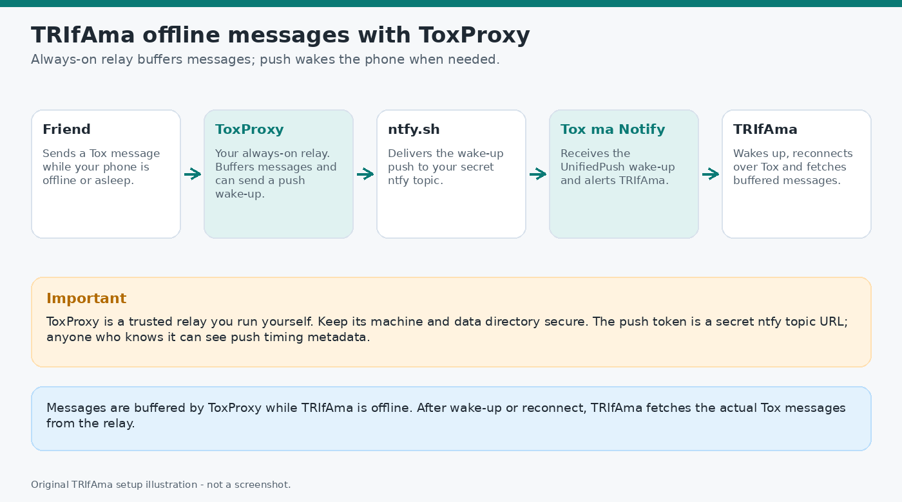
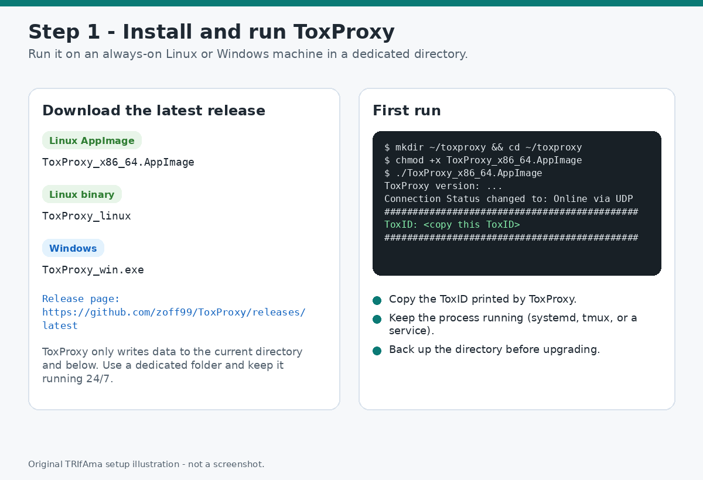
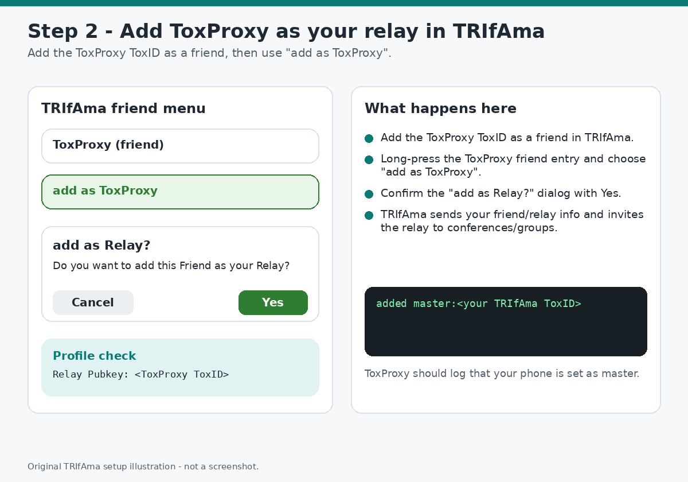
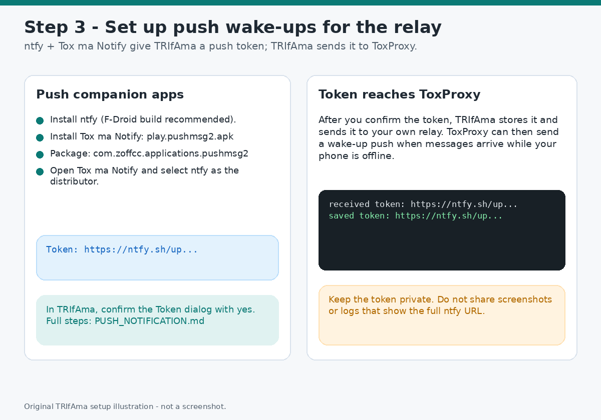
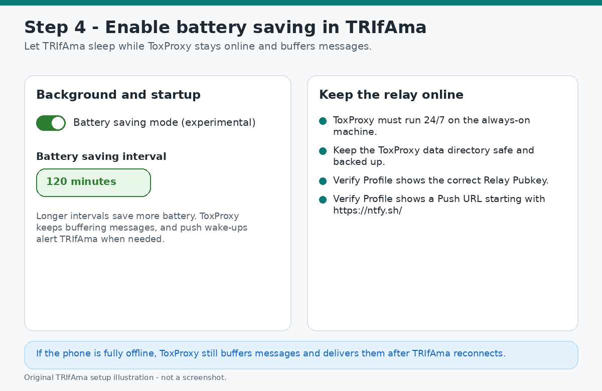
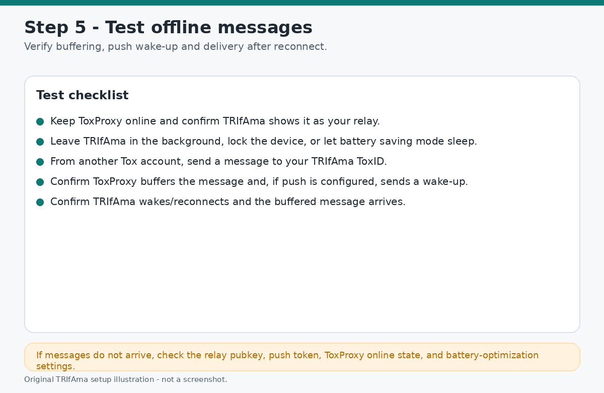

# Offline messages for TRIfAma with ToxProxy

This guide sets up offline message buffering for TRIfAma using
[ToxProxy](https://github.com/zoff99/ToxProxy), an always-on Tox relay
that you run on your own computer, combined with push wake-ups via
[ntfy.sh](https://ntfy.sh/) and
[Tox ma Notify](https://github.com/zoff99/tox_push_msg_app_2).

While your phone is offline or asleep, ToxProxy buffers incoming Tox
messages. When a message arrives, it can send a push wake-up so TRIfAma
connects and fetches the buffered messages. The Tox message content
itself is still fetched over Tox after wake-up.

> **Privacy warning:** ToxProxy is a trusted relay that you run
> yourself. It sees your friend list and stores buffered messages, so
> keep its machine and data directory secure. The push token is a
> secret ntfy topic URL; anyone who knows it can see push timing
> metadata. Keep the token private and do not share screenshots or logs
> that show the full URL.

## What you need

- TRIfAma installed and unlocked on the device.
- A computer that can stay online 24/7 (Linux or Windows; other
  platforms can build ToxProxy from source).
- ToxProxy from the official release page.
- Push wake-ups set up with ntfy and Tox ma Notify, see
  [PUSH_NOTIFICATION.md](PUSH_NOTIFICATION.md).

## How it works



1. A friend sends a Tox message while your phone is offline or asleep.
2. ToxProxy, your always-on relay, buffers the message.
3. ToxProxy sends a wake-up push to your secret ntfy topic.
4. ntfy.sh delivers it to the ntfy app, which forwards it to
   Tox ma Notify, which wakes TRIfAma.
5. TRIfAma connects over Tox and fetches the buffered messages from
   the relay.

ToxProxy only accepts control commands from your phone's Tox public
key (the "master"), so nobody else can control your relay.

## Step 1: Install and run ToxProxy



Download the latest stable release (prefer the latest release over the
`nightly` pre-release):

- Linux AppImage:
  <https://github.com/zoff99/ToxProxy/releases/latest/download/ToxProxy_x86_64.AppImage>
- Linux binary:
  <https://github.com/zoff99/ToxProxy/releases/latest/download/ToxProxy_linux>
- Windows binary:
  <https://github.com/zoff99/ToxProxy/releases/latest/download/ToxProxy_win.exe>

ToxProxy only writes data to the current directory and below, so give
it a dedicated directory and run it there:

```text
mkdir ~/toxproxy && cd ~/toxproxy
chmod +x ToxProxy_x86_64.AppImage
./ToxProxy_x86_64.AppImage
```

On first start it prints its ToxID, for example:

```text
ToxProxy version: 2.x.x
Connection Status changed to: Online via UDP
#############################################################

ToxID: <76 hex characters>

#############################################################
```

1. Copy the ToxID; you need it in Step 2.
2. Leave ToxProxy running 24/7 on the machine.
3. Keep the data directory: it holds the relay's Tox identity and the
   buffered messages. Back it up before upgrading.

## Step 2: Add ToxProxy as your relay in TRIfAma



1. Open TRIfAma and add the ToxProxy ToxID as a friend.
2. Wait until the friend request is accepted and the relay is online.
3. Long-press the ToxProxy friend entry and choose **add as ToxProxy**.
4. Confirm the **add as Relay?** dialog
   (`Do you want to add this Friend as your Relay?`) with **Yes**.
5. TRIfAma now shares your friend/relay information with the relay and
   invites it to your conferences/groups.
6. ToxProxy logs that your phone is set as master:

```text
added master: <your TRIfAma ToxID>
```

7. Open your Profile in TRIfAma and verify that **Relay Pubkey:** shows
   the ToxProxy public key.

## Step 3: Set up push wake-ups for the relay



ToxProxy can only wake your phone if it knows your push token. Set up
push first, following [PUSH_NOTIFICATION.md](PUSH_NOTIFICATION.md):

1. Install the ntfy Android app (F-Droid build recommended).
2. Install Tox ma Notify (`play.pushmsg2.apk`, package
   `com.zoffcc.applications.pushmsg2`) and select ntfy as the
   distributor.
3. In TRIfAma, confirm the **Token** dialog with **yes**.

After you confirm the token, TRIfAma sends it to your own relay
automatically. If the relay is not ready to receive packets yet,
TRIfAma retries after a short delay. ToxProxy then logs:

```text
received token: https://ntfy.sh/up...
saved token: https://ntfy.sh/up...
```

> Keep the token private. Do not share screenshots or logs that show
> the full ntfy URL.

## Step 4: Enable battery saving in TRIfAma



With a relay buffering messages and push waking the phone, TRIfAma can
sleep most of the time:

1. Go to `Settings > Background and startup`.
2. Enable **Battery saving mode (experimental)**.
3. Set **Battery saving interval (experimental)** to a suitable value,
   for example **120 minutes** for maximum battery saving.

Longer intervals save more battery. While TRIfAma sleeps, ToxProxy
buffers messages and the push wake-up brings TRIfAma back to fetch
them.

## Step 5: Test the setup



1. Keep ToxProxy running and online.
2. Leave TRIfAma in the background or lock the device.
3. Send a Tox message from another device or account.
4. ToxProxy buffers the message and sends a wake-up push.
5. Confirm that TRIfAma wakes up and the message arrives.

If the message does not arrive, work through the troubleshooting
sections below and in [PUSH_NOTIFICATION.md](PUSH_NOTIFICATION.md).

## Troubleshooting

- **ToxProxy is not online:** Check the machine's network and firewall
  and keep ToxProxy running. It connects over Tox like any other
  client.
- **No `added master:` log:** Make sure the friend request was accepted
  and both sides are online, then repeat **add as ToxProxy** and
  confirm with **Yes**.
- **No `received token:` log:** Confirm the token in TRIfAma (Token
  dialog, **yes**) and check that **Push URL:** is set in your Profile.
  TRIfAma retries sending the token to the relay after a short delay.
- **Pushes do not wake the phone:** See the troubleshooting section in
  [PUSH_NOTIFICATION.md](PUSH_NOTIFICATION.md). Exempt ntfy and
  Tox ma Notify from battery optimization.
- **Messages arrive late after wake-up:** Tox needs time to reconnect
  and fetch buffered messages. The relay must stay online the whole
  time.
- **Reinstalled ToxProxy or lost its data directory:** The relay gets a
  new ToxID. Remove the old relay in TRIfAma and add the new ToxID as
  described in Step 2.

## Removing or changing the relay

- To remove the current relay: `Profile > remove own Relay`.
- To change it: remove the old relay, add the new ToxProxy ToxID as a
  friend, choose **add as ToxProxy**, and confirm with **Yes**. TRIfAma
  sends your push token to the new relay automatically.
- Keep the old ToxProxy data directory if you want to preserve its Tox
  identity and any buffered messages.
