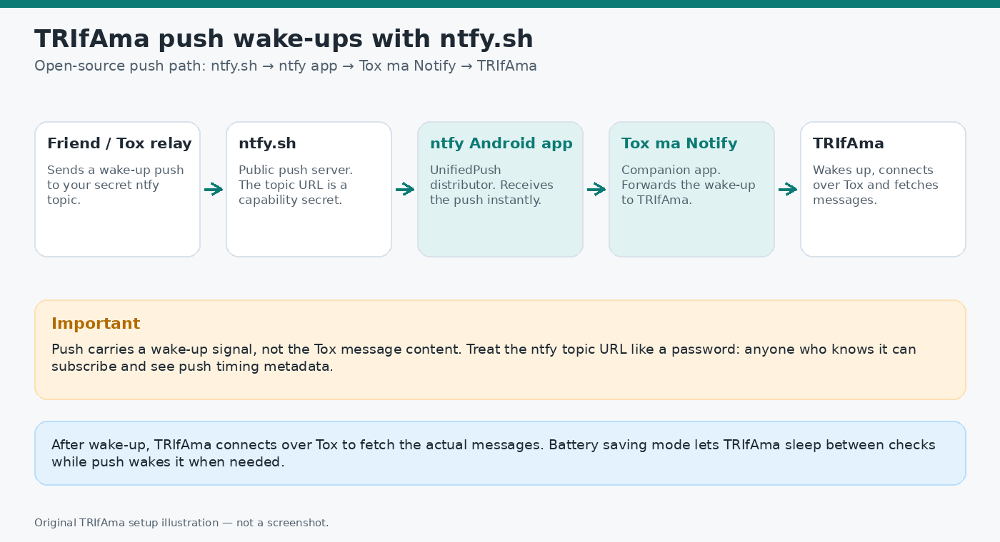
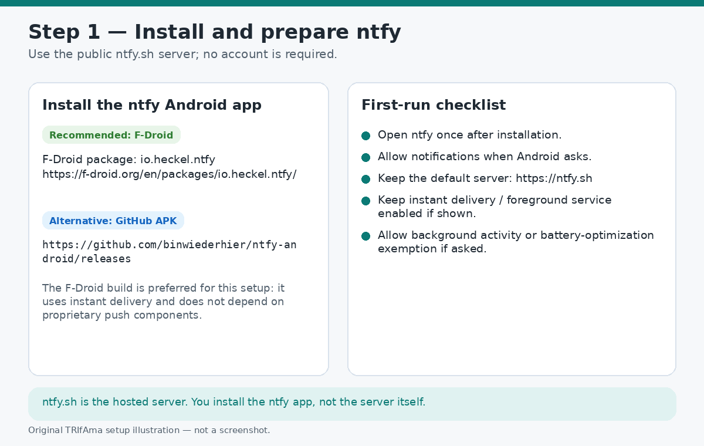
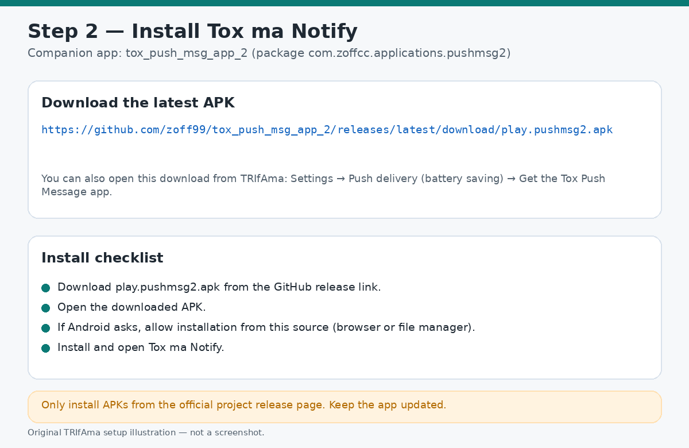
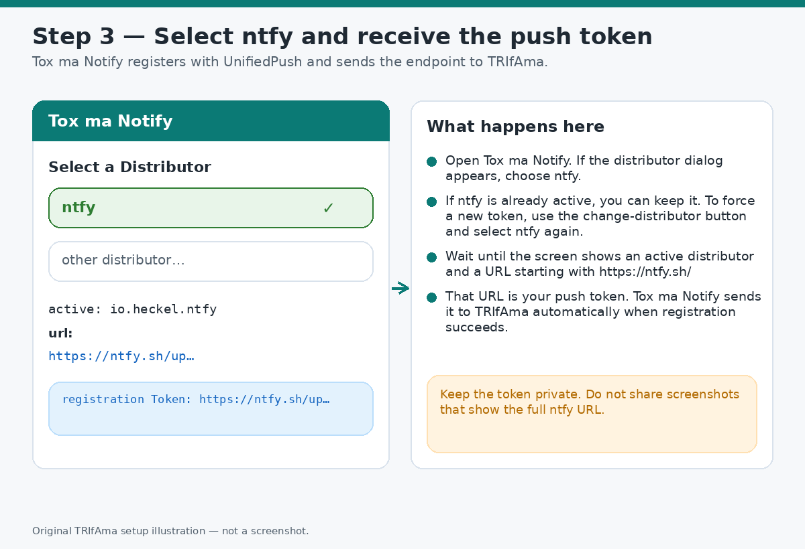
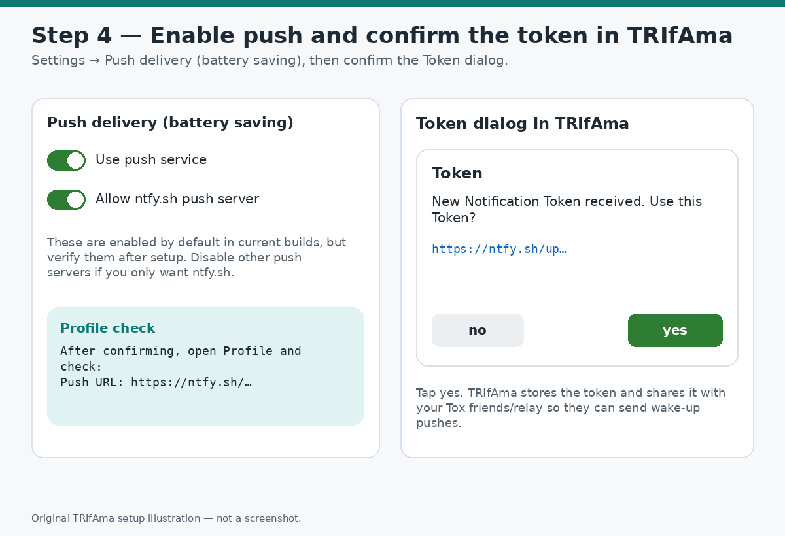
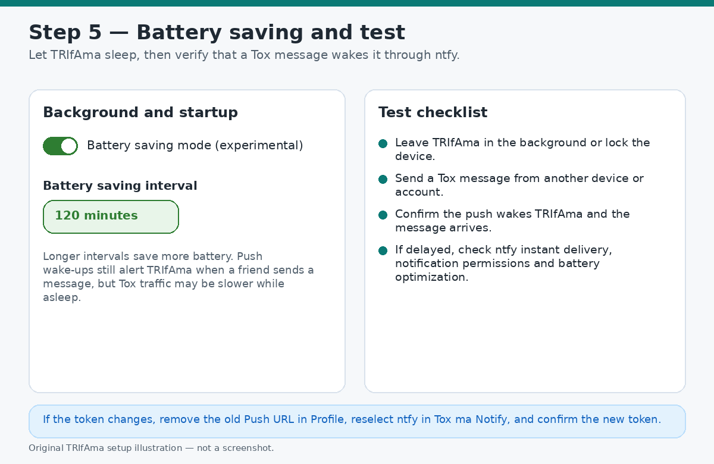

# Push notifications for TRIfAma with ntfy.sh

This guide sets up push wake-ups for TRIfAma using the public
[ntfy.sh](https://ntfy.sh/) server, the ntfy Android app, and
[Tox ma Notify](https://github.com/zoff99/tox_push_msg_app_2)
(`tox_push_msg_app_2`).

Push is used to wake TRIfAma when it is asleep. The Tox message content
itself is still fetched over Tox after wake-up.

> **Privacy warning:** The public ntfy.sh server has no accounts or
> authentication by default. Your push token is a secret ntfy topic URL.
> Anyone who learns it can subscribe and see when you receive pushes
> (timing metadata). Keep the token private and do not share screenshots
> that show the full URL.

## What you need

- TRIfAma installed and unlocked on the device.
- The ntfy Android app (F-Droid build recommended).
- Tox ma Notify (`play.pushmsg2.apk`) from the official release page.
- Internet access for the push server.

## How it works



1. A friend or Tox relay sends a wake-up push to your ntfy topic.
2. ntfy.sh delivers it to the ntfy Android app.
3. The ntfy app acts as a UnifiedPush distributor and forwards it to
   Tox ma Notify.
4. Tox ma Notify wakes TRIfAma.
5. TRIfAma connects over Tox and fetches the actual messages.

## Step 1: Install and prepare ntfy



`ntfy.sh` is the hosted server. You do not need to install the server
yourself; install the ntfy Android app and keep the default server.

1. Install ntfy from F-Droid (recommended):
   <https://f-droid.org/en/packages/io.heckel.ntfy/>
   Alternative APKs:
   <https://github.com/binwiederhier/ntfy-android/releases>
2. Open ntfy once.
3. Allow notifications when Android asks.
4. Keep the default server: `https://ntfy.sh`.
5. If your build shows instant delivery / foreground service, keep it
   enabled.
6. If Android asks, allow background activity or exempt ntfy from
   battery optimization.

The F-Droid build is preferred for this setup because it uses instant
delivery and does not depend on proprietary push components.

## Step 2: Install Tox ma Notify



Tox ma Notify is the companion app that receives UnifiedPush messages
and forwards wake-ups to TRIfAma.

Download the latest APK:
<https://github.com/zoff99/tox_push_msg_app_2/releases/latest/download/play.pushmsg2.apk>

Or open the download from TRIfAma:
`Settings → Push delivery (battery saving) → Get the Tox Push Message app`.

1. Download `play.pushmsg2.apk`.
2. Open the downloaded APK.
3. If Android asks, allow installation from this source.
4. Install and open Tox ma Notify.

Package name: `com.zoffcc.applications.pushmsg2`.

## Step 3: Select ntfy and receive the push token



1. Open Tox ma Notify.
2. If the **Select a Distributor** dialog appears, choose **ntfy**.
3. If ntfy is already active, you can keep it. To force a new token, use
   the change-distributor button and select ntfy again.
4. Wait until the screen shows an active distributor and a URL starting
   with `https://ntfy.sh/`.

The displayed URL is your push token, for example:

```text
https://ntfy.sh/up…
```

Tox ma Notify sends this endpoint to TRIfAma automatically when
registration succeeds. If TRIfAma is not running, Android may show a
"new Token" notification. Open TRIfAma and continue to Step 4.

> Keep the token private. Anyone who knows the ntfy topic URL can see
> push timing metadata.

## Step 4: Enable push in TRIfAma and confirm the token



1. Open TRIfAma and unlock it.
2. Go to `Settings → Push delivery (battery saving)`.
3. Verify:
   - **Use push service** is enabled.
   - **Allow ntfy.sh push server** is enabled.
4. If the **Token** dialog appears, it says:
   `New Notification Token received. Use this Token?`
   Tap **yes**.
5. Open your Profile and verify that **Push URL:** shows a URL starting
   with `https://ntfy.sh/`.

Tapping **yes** stores the token and shares it with your Tox friends and
relay so they can send wake-up pushes. If you tap **no**, the pending
token is discarded.

These push settings are enabled by default in current builds, but verify
them after setup. Disable other push servers if you only want ntfy.sh.

## Step 5: Battery saving and test



1. Go to `Settings → Background and startup`.
2. Enable **Battery saving mode (experimental)**.
3. Set **Battery saving interval (experimental)** to a suitable value,
   for example **120 minutes** for maximum battery saving.
4. Leave TRIfAma in the background or lock the device.
5. Send a Tox message from another device or account.
6. Confirm that the push wakes TRIfAma and the message arrives.

Longer intervals save more battery, but Tox traffic may be slower while
the app is asleep. Push wake-ups still alert TRIfAma when a friend sends
a message.

## Troubleshooting

- **No distributor listed:** Open ntfy once, grant permissions, update
  ntfy, then reopen Tox ma Notify.
- **No URL / registration failed:** Check network access and the ntfy
  server. Reselect ntfy as the distributor.
- **TRIfAma does not ask to confirm:** Open TRIfAma unlocked. Check for
  a "new Token" notification. Reselect ntfy to force a new endpoint.
- **Pushes are delayed:** Enable instant delivery / foreground service
  in ntfy, allow notifications, and exempt ntfy and Tox ma Notify from
  battery optimization.
- **Wrong or old token:** In Profile, tap **remove Push URL**, then
  reselect ntfy in Tox ma Notify and confirm the new token.
- **Messages still slow:** Battery saving mode trades latency for
  battery. Push wakes the app, but Tox connection and fetch may take
  time.

## Removing or changing the token

- To remove the current token: `Profile → remove Push URL`.
- To change it: remove the old token, use the change-distributor button
  in Tox ma Notify, select ntfy again, and confirm the new token in
  TRIfAma.
